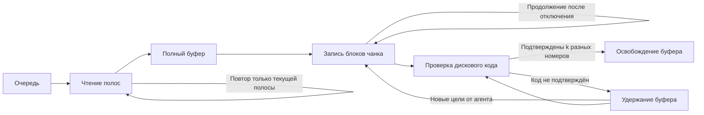

# I4.3. Возобновляемые префиксы и последний полный буфер

Дата: 10 ноября 2026 года.

## Что изменилось

`ResumableLedger` наследует I4.2, но не меняет его исходники или результаты. Целый объект читается последовательно полосами; каждая успешно проверенная полоса остаётся в памяти. Один сбой не сбрасывает весь предыдущий прогресс. При записи аналогично сохраняется префикс одного нового чанка. Уничтожение диска сбрасывает незавершённую запись; обычное отключение — сохраняет её.

Сервер один: подготовка, чтение, запись и проверки используют общий канал. Удержание буфера сохраняет приоритет данного объекта и может блокировать остальные задания. Это сознательный компромисс, а не оптимальное расписание.

## Полосы чтения

Объект делится на 16 равных полос. Каждая полоса декодируется из соответствующих частей k разных целых чанков. Источники можно менять перед очередной полосой; внутри неё выбранные копии должны остаться целыми и доступными. Неудача повторяет текущую полосу через час. Будущий конец простоя не используется.

$$
d_j^{\mathrm{read\ stripe}} = \frac{B_j}{24 \cdot v \cdot M}.
$$

где:
- d_j^{read stripe} — длительность одной попытки чтения полосы, в сутках;
- j — задание;
- B_j — размер полного объекта;
- v — общий бюджет передачи, в единицах размера объекта в час;
- M — число полос, в пилоте 16;
- 24 — число часов в сутках.

Передаваемый объём включает части всех k источников. Успешно декодированная полоса содержит соответствующую часть полного объекта. Подготовка выполняется один раз на задание. При отсутствии k доступных источников сохраняется уже декодированный префикс, а попытка подключения повторяется через час.

В медленном профиле I4.2 чтение требовало 50 часов непрерывной доступности. Теперь одна полоса требует 3,125 часа; подтверждённые предыдущие полосы не перечитываются. Часовые паузы, стоимость повторных полос и неизменившиеся требования к доступности внутри полосы остаются в модели.

## Префикс записи и поколение диска

$$
d_j^{\mathrm{write\ block}} = \frac{B_j}{24 \cdot k \cdot v \cdot M}.
$$

где:
- d_j^{write block} — длительность попытки записи одного блока чанка, в сутках;
- j — задание;
- B_j — размер полного объекта;
- k — число разных чанков для восстановления;
- v — бюджет передачи в час;
- M — число блоков одного чанка, равное числу полос объекта;
- 24 — число часов в сутках.

В медленном профиле блок записи занимает 1,5625 часа. Полный новый чанк появляется после последнего подтверждённого блока. Каждое уничтожение диска меняет его поколение. Блок, начатый до уничтожения и закончившийся после, не засчитывается; прежний префикс этого получателя сбрасывается. При обычном простое поколение не меняется, и запись продолжается с прежнего подтверждённого места.

Получателя ожидают до T_rep после первого неудачного подключения. После этого незавершённое назначение можно отменить лишь через подтверждение целого дискового кода. Такая отмена не считается созданием замены и не означает, что требуемый резерв восстановлен.

## Почему частичный префикс не равен полному буферу

Префиксы всегда последовательные: от первой полосы к последней. Любой незавершённый префикс не содержит последнюю полосу. Мир повреждает целые чанки, не отдельные полосы. Поэтому последняя полоса всего объекта по-прежнему требует k разных полных дисковых номеров, пока не появился полный буфер.

Это обосновывает сохранение прежнего точного условия восстановимости целого объекта в этой ограниченной модели: достаточно k целых номеров на дисках либо существует полный буфер. Частичный префикс уменьшает повторный трафик, но не создаёт весь отсутствующий суффикс. Это утверждение нельзя переносить на произвольный порядок блоков, разреженные наборы полос или частичное повреждение чанков.

Отказ центральной памяти сбрасывает декодированный префикс и полный буфер данного объекта. Если полный дисковый код уже недостаточен, информация теряется. Одного наличия незавершённой части нового чанка для спасения целого объекта недостаточно. Событие отказа памяти предусмотрено для контролируемых проверок, случайная частота таких отказов не калибровалась.

## Безопасное освобождение полного буфера

Буфер больше не удаляется после одной попытки записи. Перед освобождением выполняется отдельная проверка k разных целых номеров в активной карте. Она занимает тот же канал, имеет подготовку 0,05 часа и объём:

$$
V_j^{\mathrm{close}} = \eta \cdot B_j.
$$

где:
- V_j^{close} — бюджет передачи закрывающей проверки задания j;
- j — задание;
- eta — доля служебной проверки, в пилоте 0,01;
- B_j — размер полного объекта.

Успех требует целостности и доступности выбранных копий на интервале проверки. При отказе буфер сохраняется. Неудачная проверка целостности на доступном узле отражается как наблюдаемый отрицательный аудит; истина будущего в опыт агента не передаётся.

Если недостаточно разных номеров, агент может передать новые получатели через обычный запрос ремонта. Они добавляются текущему заданию и записываются из удерживаемого буфера. Принудительного удаления здорового последнего буфера по TTL нет. Отсутствие ёмкости, доступных получателей или подтверждений может удерживать его до конца горизонта.

## Память и цена

Декодированный префикс постепенно занимает центральную память до размера полного объекта. На последней полосе он превращается в полный буфер атомарно, без удвоения расхода. В пилоте максимум центральной памяти — один объект; этот предел проверен по интервалам хранения.

Префикс записи хранится во временной области получателя до размера одного чанка. При полном подтверждении он превращается в полную копию. При завершении/отмене задания временная область освобождается по абстрактному протоколу очистки. Отдельная задержка очистки и её взаимодействие с другими записями пока не моделируются. Выделенный слот полной копии остаётся зарезервированным до подтверждения или отмены.

$$
C_{\mathrm{prefix}} = \sum_p s_p \cdot \max\!\left(0,\ \min(b_p,T) - a_p\right).
$$

где:
- C_prefix — расход хранения проверенных блоков префиксов, в объёмо-сутках;
- p — проверенный блок префикса;
- s_p — размер этого блока;
- a_p и b_p — моменты начала и окончания его удержания;
- T — конец выполненного горизонта;
- min и max — операции обрезки длительности по горизонту.

Центральный декодированный префикс и временная область получателя учитываются отдельно. Они не прибавляются к числу полных чанков. Тариф памяти и вероятность её отказа пока не оценены, поэтому снижение переданного бюджета не объявляется денежной экономией.

## Испытание и следующий вопрос

Параметры заданы в [EXPERIMENT_I43.md](../../subprojects/taris_variants/EXPERIMENT_I43.md). Три мира 15–17 сравниваются попарно с неизменённой I4.2; три мира 18–20 служат новой проверкой. Численные результаты и ограничения — [ANALYSIS_I43.md](../../subprojects/taris_variants/ANALYSIS_I43.md).

Размещение и актуарный порог агентов пока используют прежние модели. Следующий вопрос — как агенту выбирать срочность ремонта и запас с учётом очереди, памяти и задержек, а также как не блокировать полезную работу канала при удержании последнего буфера. Это требует отдельного протокола и сравнения, а не объявления прежнего оконного cap гарантией нового исполнения.
