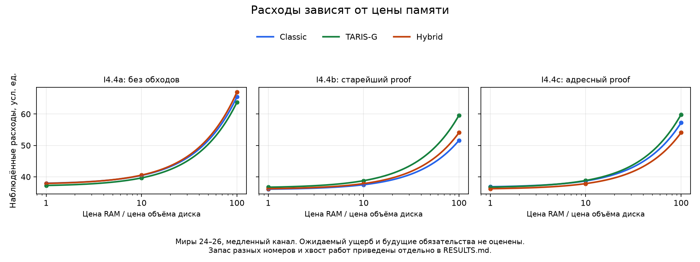

# I4.5b. Цена наблюдённых ресурсов

Дата: 11 ноября 2026 года.

Расходы пересчитаны по тем же журналам, без новых миров и решений агентов. Учтены полные физические копии, декодированные префиксы, полные буферы, временная область получателя и обслуженный бюджет канала. Это начисленные расходы к горизонту; ожидаемый ущерб и будущие обязательства остаются неоценёнными.

## Единицы цены

Из прежнего `Costs` сохранены числовые основания: одна триста шестьдесят пятая условной единицы за фрагмент в сутки и 0,1 за единицу бюджета передачи. Цены модельные. Тариф памяти переводится в объёмные единицы:

$$
v_{\mathrm{size}} = \frac{v \cdot k}{B}.
$$

где:
- v_size — цена единицы объёма диска в сутки;
- v — цена полного фрагмента в сутки;
- k — число разных фрагментов для восстановления;
- B — фиксированный размер полного объекта.

В текущих сериях размер объекта один, код требует два фрагмента. Центральная память тарифицируется с множителем 1, 10 или 100 к цене объёма диска, временная область — с множителем 1 либо 10. Это чувствительность фиксированных траекторий к условным ценам, а не переобучение политик под новую цену.

## Начисленный расход

$$
C_{\mathrm{obs}}(T) = v \cdot F(T) + v_{\mathrm{size}} \cdot \alpha \cdot \left(M_{\mathrm{full}}(T) + M_{\mathrm{prefix}}(T)\right) + v_{\mathrm{size}} \cdot \beta \cdot M_{\mathrm{recv}}(T) + c_{\mathrm{tr}} \cdot V_{\mathrm{served}}(T).
$$

где:
- C_obs(T) — условная начисленная стоимость ресурсов к концу горизонта;
- T — конец выполненного наблюдения;
- v — цена фрагмента в сутки;
- F(T) — хранение полных копий в копие-сутках;
- v_size — цена единицы объёма диска в сутки;
- alpha — относительная цена центральной памяти;
- M_full(T) — хранение полных буферов в объёмо-сутках;
- M_prefix(T) — хранение декодированных префиксов в объёмо-сутках;
- beta — относительная цена временной области получателя;
- M_recv(T) — хранение подтверждённых префиксов записи в объёмо-сутках;
- c_tr — цена единицы обслуженного бюджета канала;
- V_served(T) — обслуженный к горизонту бюджет, включая неуспешные попытки и проверки.

Полный буфер заменяет декодированный префикс того же объекта. Их одновременный учёт за один интервал отвергается; граница перехода не создаёт двойного начисления. Частичная фаза канала обрезается по горизонту. Будущая часть назначенной фазы не записывается как уже оплаченная.

Дисконтирование в этом учёте нулевое. Это не изменение параметров прежних решений агента и не подмена денежного резерва Тиле. Резервирование места, подготовка процессора, контрольные сообщения и детали очистки временной области не получили отдельной денежной цены. Их отсутствие в сумме — граница модели, не утверждение, что они бесплатны.

## Что показала чувствительность

В адресном режиме на общих мирах 24–26 расход Classic и G меняется местами примерно при относительной цене памяти 5,136. Это алгебраическая граница сравнения двух фиксированных наборов расходов, не статистически установленный тариф.

При дешёвой памяти G немного дешевле, но дольше находится ниже запрошенного запаса четырёх номеров и имеет больший хвост. При дорогой памяти его расход уже выше Classic. Даже совпадение цены не делает их одинаковыми по сохранности или незавершённой работе.

Полная сетка — 432 расчёта по 72 существующим исполнениям; 144 сводные строки. Новых независимых испытаний нет. Ожидаемый ущерб, будущая стоимость хвоста и полный актуарный резерв представлены как неизвестные величины, а не нули.

Результаты и границы — [ANALYSIS_I45B.md](../../subprojects/taris_variants/ANALYSIS_I45B.md). Протокол — [EXPERIMENT_I45B.md](../../subprojects/taris_variants/EXPERIMENT_I45B.md).
