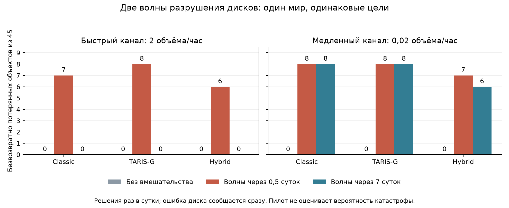

# Сохранность между двумя волнами разрушения — I5

Отдельный адаптер `disk_stress.py` использует те же физические копии, транспорт, поколения дисков и очередь, что I4.4c. После разового уничтожения диска приходит подтверждённое уведомление с собственной причиной ошибки. Обычные скрытые отказы не получают такое уведомление. Расписание не выдаётся политике.

Физический запас объекта:

$$
r_o(t) = \left|\left\{i:\text{существует физическая копия номера }i\text{ объекта }o\text{ в момент }t\right\}\right|.
$$

где:

- r_o(t) — число различных существующих номеров фрагментов объекта;
- o — идентификатор объекта;
- t — момент времени, сутки;
- i — номер фрагмента;
- вертикальные черты — число элементов множества.

Несколько копий одного номера не увеличивают кодовый ранг. В текущем последовательном протоколе неполные префиксы не содержат последний блок целого объекта, поэтому не заменяют полный буфер при потере кода. Начало безвозвратной потери:

$$
\tau_o = \inf\left\{t:r_o(t)<k\ \land\ F_o(t)=0\right\}.
$$

где:

- \tau_o — момент первой безвозвратной потери объекта;
- o — идентификатор объекта;
- t — время после приёма объекта;
- r_o(t) — число различных физических номеров;
- k — число номеров для декодирования;
- F_o(t) — индикатор полного здорового буфера объекта у контроллера;
- inf — самый ранний момент множества; при отсутствии такого момента потеря не наступила.

Внешний аудит измеряет эту истину; агент не получает её как признак.

## Частота решений имеет значение

Уведомление о сбое доставляется в момент ошибки, но политика принимает решения раз в сутки. События ровно на границе решения ещё не обработаны — сохранён исходный порядок симулятора. Первая волна в15, следующая близкая в15,5; первое новое суточное решение после первой волны — в16. Быстрый канал не устраняет этот период ожидания решения.

$$
\delta(t) = \min\left\{d-t:d\in D,\ d>t\right\}.
$$

где:

- \delta(t) — задержка до следующего решения после события;
- t — момент события;
- d — момент решения;
- D — набор суточных границ решений;
- строгий знак больше соответствует наблюдению на границе слева в текущем исполнителе.

## Парный пилот

Мир40, 45 суток, 24 исходных узла, k=2, n=4. Три наиболее населённых начальных ДЦ выбираются по публичному реестру с детерминированным разрешением равенств. Два первых поражаются в15, третий — в15,5 либо22. Контроль не имеет волн. Те же цели, мир, входы и политики во всех ветвях. Получены18исполнений, но независимый внешний мир один.

| Интервал между волнами | Канал | Classic: потерь | G: потерь | Hybrid: потерь |
|---|---|---:|---:|---:|
| без волн | быстрый/медленный | 0 | 0 | 0 |
| 0,5суток | быстрый | 7 | 8 | 6 |
| 0,5суток | медленный | 8 | 8 | 7 |
| 7суток | быстрый | 0 | 0 | 0 |
| 7суток | медленный | 8 | 8 | 6 |

Пилот показывает зависимость сохранности от времени реакции и обслуживания. Он не доказывает рейтинг агентов или вероятность катастрофы. В этом пилоте нет периодов спасения только буфером; защиту буфера подтверждают отдельные контролируемые тесты, а не эта таблица.

Экспозиция ровно k и ниже целевого n отдельно считается до первого момента потери каждого объекта. Полная экспозиция за горизонт также сохранена, но включает время после безвозвратного исхода. Меньшая наблюдённая стоимость при потере копий не означает экономии: исчезают и расходы хранения, и информация.

Стресс-тяжесть в единицах информации:

$$
Z_s = \sum_{o\in A_s} B_o\cdot\mathbf{1}\left(\tau_o\leq T\right).
$$

где:

- Z_s — объём принятой информации, потерянной в сценарии s;
- s — конкретное расписание волн и исполнения;
- A_s — объекты, успешно принятые не менее чем с k различными номерами;
- o — объект;
- B_o — размер исходной информации объекта;
- \mathbf{1} — индикатор выполнения условия;
- \tau_o — момент безвозвратной потери;
- T — конец горизонта.

Вероятности стресс-сценариев и денежная тяжесть потери пока не оценены. Поэтому полученные Z_s нельзя объявлять математическим ожиданием ущерба или полным актуарным резервом. Следующий этап — повторение на заранее выделенных мирах и чувствительность к интервалу волн с учётом суточного решения.

Проверки: семь новых тестов; полная серия151тест OK; повторный физический/транспортный и парный аудит18исполнений; источники и внешний мир неизменны; до первой волны наблюдаемое прошлое совпадает. Старый аудитор дополнен явной проекцией точечных разрушений, его прежние инварианты сохранены.
