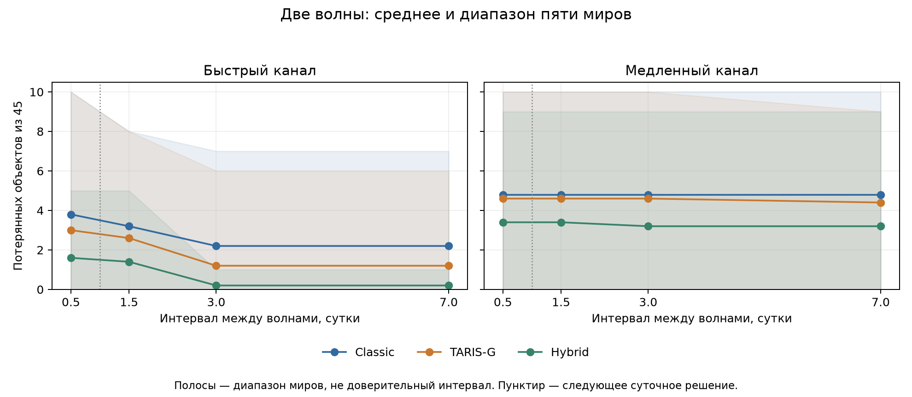

# Интервал волн, накопление риска и уязвимость размещения — I5.1

Серия зафиксирована до просмотра результатов: миры101–105,45суток,k=2,n=4; контроль и интервалы0,5/1,5/3/7суток, два канала, три агента. Получено150исполнений, но независимых внешних миров пять. Пилот40 не включён в средние.

## Непосредственная уязвимость

Число номеров, переживающих уничтожение доменов:

$$
r_o^{\mathrm{surv}}(S,t) = \left|\left\{i:\exists f\in P_o(t),\ \operatorname{idx}(f)=i,\ \operatorname{dc}(f)\notin S\right\}\right|.
$$

где:

- r_o^{\mathrm{surv}}(S,t) — число различных номеров объекта вне поражаемых доменов;
- o — объект;
- S — множество уничтожаемых доменов ДЦ;
- t — момент непосредственно перед волной;
- i — номер фрагмента;
- f — физическая копия;
- P_o(t) — существующие копии объекта перед волной;
- \operatorname{idx}(f) — номер фрагмента копии;
- \operatorname{dc}(f) — домен размещения копии;
- вертикальные черты — число элементов множества.

Если информация ещё восстановима, но после волны остаётся меньше k номеров и нет полного буфера, она немедленно теряется. Дубликат номера вне поражённого домена полезен, но несколько дубликатов одного номера не образуют код.

Обобщённый физический запас к b доменным отказам:

$$
g_o(b,t) = \min_{S:\left|S\right|\leq b} r_o^{\mathrm{surv}}(S,t) - k.
$$

где:

- g_o(b,t) — минимальный избыток различных номеров относительно декодирующего порога;
- o — объект;
- b — число одновременно поражаемых доменов;
- t — момент оценки;
- S — множество доменов, содержащее не больше b элементов;
- r_o^{\mathrm{surv}}(S,t) — число переживающих номеров;
- k — порог декодирования.

Это внешний физический критерий, не автоматически известная агенту величина. В плане нового размещения можно проверять аналог по подтверждённым назначениям, но скрытые потери и давность аудита требуют отдельной поправки. При одном номере в каждом из четырёх ДЦ и k=2 два доменных отказа оставляют код; четыре номера в двух ДЦ могут исчезнуть сразу. Одного количества чанков недостаточно.

## Результат по пяти мирам

Среднее потерянных объектов из45:

| Интервал | Быстрый Classic/G/Hybrid | Медленный Classic/G/Hybrid |
|---|---|---|
| контроль | 0/0/0 | 0/0/0 |
| 0,5суток | 3,8/3,0/1,6 | 4,8/4,6/3,4 |
| 1,5суток | 3,2/2,6/1,4 | 4,8/4,6/3,4 |
| 3суток | 2,2/1,2/0,2 | 4,8/4,6/3,2 |
| 7суток | 2,2/1,2/0,2 | 4,8/4,4/3,2 |

На быстром канале при3и7сутках все оставшиеся потери относятся к первой волне. Их непосредственная уязвимость точно восстановлена внешним аудитом размещения. В отличие от пилота40, большой интервал не гарантирует нулевую потерю: он не возвращает информацию, уже уничтоженную первым ударом.

На медленном канале дополнительные потери возникают на второй волне и позже. Более низкая средняя Hybrid не означает универсального доминирования: в мире104 медленный Hybrid потерял9объектов, Classic5, G8. Выводы относятся к выбранному стресс-дизайну; реальные частоты сценариев неизвестны.

## Очередь — отдельный источник уязвимости

Внешняя диагностика нашла36незавершённых заданий со статусом ожидания источников. Во всех36на конце горизонта физически доступных различных номеров хватало для декодирования, а проверки копий были в очереди либо отклонялись из-за заполнения. Это кандидат на блокировку служебного подтверждения карты, не доказанный причинный эффект конкретного исправления. Нужна отдельная абляция при неизменённой серии I5.1.

Ресурсные расходы и тяжесть разделены. Для ветви с интервалом7суток условная граница цены информации между быстрым и медленным каналами составляет примерно1,685/1,805/1,720для Classic/G/Hybrid при RAM×1. Это единицы модельной цены на единицу исходной информации, только данная ветвь и только учтённые расходы; инфраструктурная премия быстрого канала не включена. Реальная цена информации и веса сценариев не оценены, полная смесь остаётся неизвестной.

Полосы показывают min/max миров, не доверительные интервалы. Источники: `series_i51/`, `stress_sensitivity_i51/`, `ANALYSIS_I51.md`. Повторный аудит проверил150исполнений и300пар общих историй; отдельный checker пересчитал ресурсы, средние и условные границы. Это проверка механизма сохранности, не подтверждение заданного редкого лимита риска и не решение оптимизации числа чанков.
