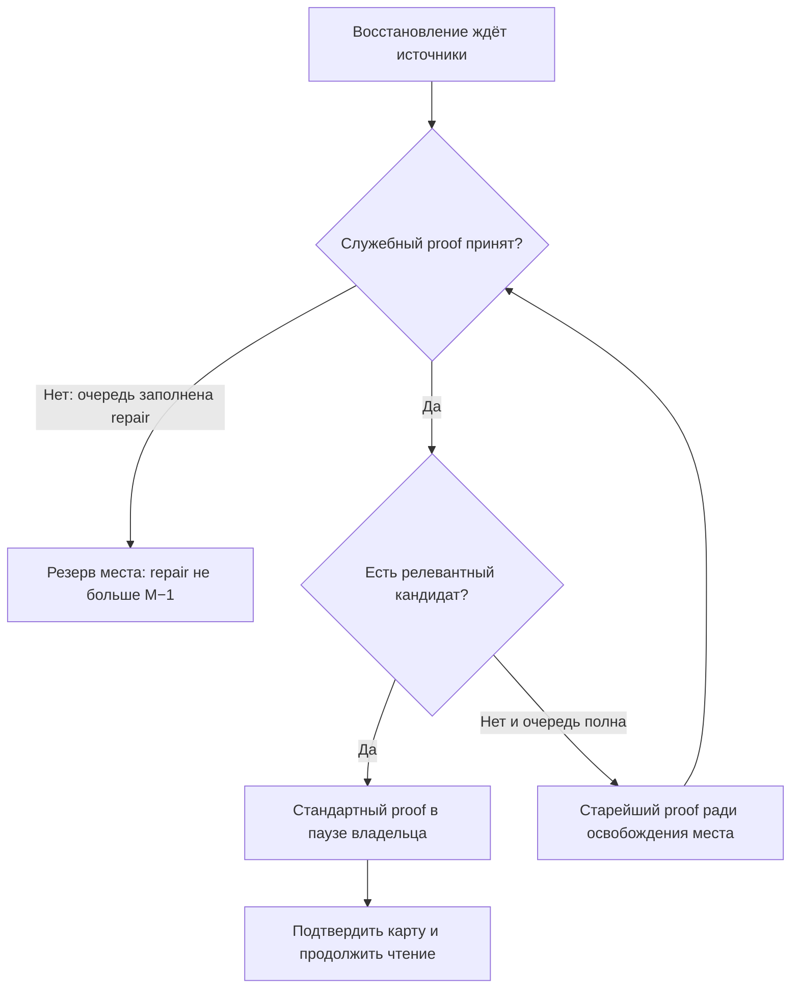

# Служебные проверки и сохранение информационного запаса — I6–I6.1

Физически существующая копия может отсутствовать в текущей карте после таймаута. До подтверждения её нельзя считать действующим источником. Если восстановление ждёт карту, а проверка копий ждёт за ним, свободная пропускная способность сама по себе не помогает.

Общий размер очереди:

$$
Q(t) = R(t) + P(t) \leq M.
$$

где:

- Q(t) — число незавершённых заявок, ожидающих и обслуживаемых;
- t — момент времени;
- R(t) — число repair-заявок, включая приостановленного владельца;
- P(t) — число proof-заявок;
- M — общий лимит очереди.

Один идентификатор владельца учитывается один раз, даже если запрос временно маршрутизируется ему во время чужого proof. Для служебного резерва:

$$
R(t) \leq M - 1.
$$

где:

- R(t) — число незавершённых repair-заявок;
- t — время;
- M — общий предел, не меньше двух.

Ограничение не отменяет общий предел Q. Новая цель уже существующему владельцу полного буфера не является новой заявкой и не должна отвергаться этим резервом.

## Доступ к серверу

I6 разрешает одну старейшую релевантную proof-проверку на часовую паузу ожидания источников. Частичный декодированный префикс остаётся у владельца; чужое repair-чтение в его память не начинается. При отказе собственной памяти префикс сбрасывается по прежним правилам. Пробуждение владельца не прерывает уже начатый proof.

Релевантность определяется rawmissing и прежними подтверждёнными размещениями. Текущая скрытая целостность не участвует. Неуспешная проверка не восстанавливает карту.

I6.1 добавляет узкое исключение: на свободном канале можно взять старейший нерелевантный proof, если одновременно выполнены условия:

- владелец находится в read-wait паузе и не имеет полного буфера;
- очередь достигла общего лимита;
- релевантных кандидатов нет, но proof-заявки есть;
- часовая пауза ещё не истекла и её квота не использована.

В журнале явно записывается pressure_fallback и глубина очереди. Аудитор проверяет реальные события начала обслуживания, тип паузы, отсутствие релевантных кандидатов и лимит. Ложное изменение relevant_indices или подстановка полного буфера не допускаются.

## Причинный диагностический результат

В I6 на мире103 combined снизил быстрый хвост8/8/8до0/0/0. Медленный остался7/8/7. I6.1 перевёл медленный G из waiting_read_sources в активную передачу; хвост8→7, подтверждённые возвраты карты0→4, экспозиция ниже n=4уменьшилась455,953→415,179объекто-суток. Остальные пять исполнений не изменились. Это уже открытый мир, не независимая проверка.

Стоимость прогресса положительна: больше оплаченного объёма и хранения. Во всех этих диагностических режимах потерь0, поэтому улучшение очереди не доказывает уменьшение безвозвратных потерь. Истинная доступность физических копий также не равна готовности пользовательского чтения через текущую карту.

В метриках parked_owner_days — длительность всех пауз владельца, parked_read_wait_days — паузы данного типа, parked_buffer_days — оставшийся прежний тип. Это не объём-сутки здоровой памяти: фактические ресурсы считаются по отдельным buffer/prefix-интервалам. Подготовка и контрольные сообщения пока не имеют полной денежной оценки; будущий хвост и полный актуарный резерв неизвестны.

Исполнители и аудиторы отдельные; старые серии не переписаны. Материалы — `ANALYSIS_I6.md`, `ANALYSIS_I61.md`, `queue_evaluation_i6/`, `queue_drain_evaluation_i61/`. Следующая проверка должна использовать новые миры с заранее фиксированными правилами.
