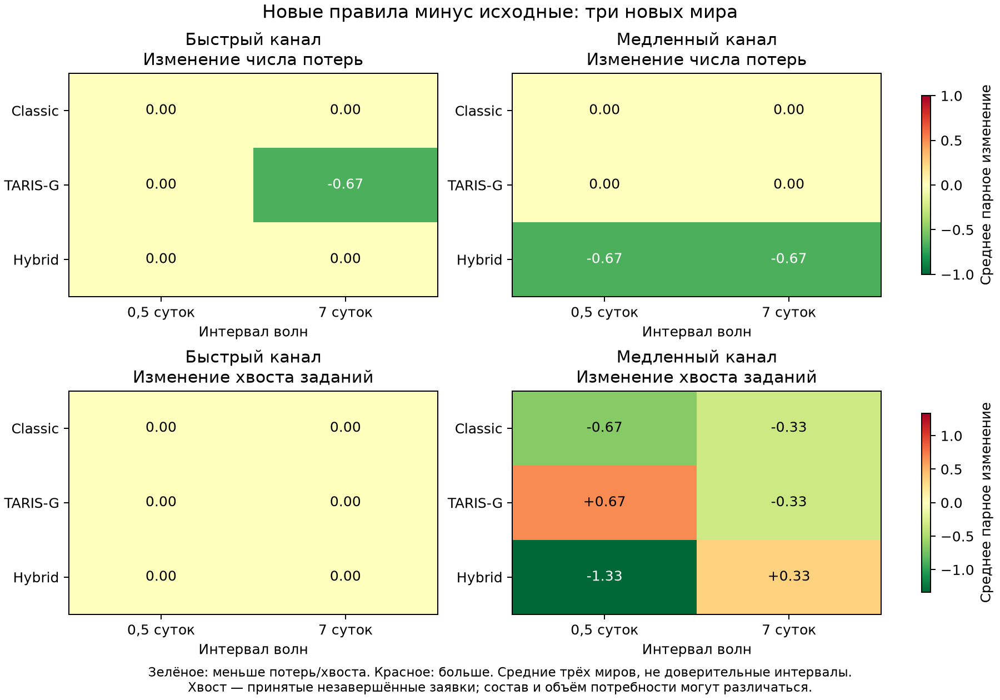

# Независимая проверка очереди — I6.2

Миры201–203не участвовали в разработке I6/I6.1. Протокол заранее зафиксировал два интервала волн, три правила исполнения, два канала и три варианта агента.108исполнений относятся к трём независимым внешним мирам.

Правила агентов, очереди и вмешательств не менялись между разработкой и проверкой: хеши прежних источников совпали. Шесть контрольныхlegacy201/closeисполнений совпали с исходным DiskStressLedger. Отдельный аудит повторил физические/транспортные проверки и54пары общей истории до разницы во времени второй волны.

Парная разность потерь:

$$
\Delta L_{w,s,h,a} = L^{\mathrm{pressure}}_{w,s,h,a} - L^{\mathrm{legacy}}_{w,s,h,a}.
$$

где:

- \Delta L_{w,s,h,a} — изменение числа безвозвратных потерь, отрицательное значение означает меньше потерь;
- w — внешний мир201,202или203;
- s — closeилиfar, два заранее заданных интервала волн;
- h — профиль канала, быстрый или медленный;
- a — вариант агента Classic,GилиHybrid;
- L^{\mathrm{pressure}}_{w,s,h,a} — число потерь с полным набором новых правил;
- L^{\mathrm{legacy}}_{w,s,h,a} — число потерь с исходным исполнением.

Таких сравнений36, но независимых миров три. Три улучшения потерь относятся к одному миру201: быстрыйG/far2→0, медленныйHybrid/closeиfar12→10. В остальных33сравнениях потери не изменились; увеличения на этой выборке нет. Это эмпирический результат выбранных сценариев, не доказанная вероятность редкой потери.

Хвост заявок улучшился в6сравнениях, не изменился в28и вырос в2. Он отражает принятые незавершённые заявки: иной приём/разбиение задач может увеличить число при одновременном прогрессе. Поэтому его нельзя трактовать как единственную меру потребности в восстановлении.

Дополнительный pressure_fallback против combined дал2улучшения потерь и34равенства; хвост улучшился в5случаях, остальные31без изменения. По всем108исполнениям21запуск fallback. Средние расходы и экспозиция ниже целевого запаса не улучшились повсеместно.

Вывод: решение служебной блокировки имеет причинную проверку и ограниченный перенос, но не является универсальным улучшением всех критериев. Оно остаётся явно выбираемым экспериментальным исполнителем. Основная модель не изменена; ожидаемый ущерб, будущие затраты всего хвоста и полный актуарный резерв неизвестны.

Файлы `series_i62/`, `queue_validation_i62/`, `ANALYSIS_I62.md`. Следующий шаг — минимальное число разных фрагментов и доменная устойчивость первоначального размещения: время обслуживания не исправляет код, уже уничтоженный первой волной.
